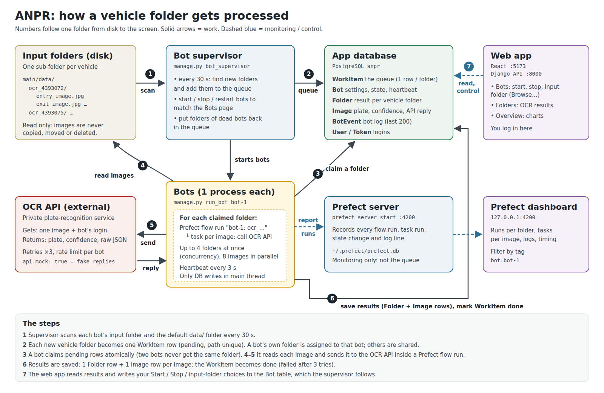

# ANPR

Automatic number-plate reading. Cameras drop one folder of images per vehicle. The folders go down an **assembly line** of stages (reading → preprocessing → OCR → LLM → trip); each stage has its own **bots**. OCR bots send each image to a private **OCR API**; plates, confidence and timing are stored in **PostgreSQL** and shown in a **web app**.

- **How to use it**: this file.
- **How it works inside** (queue, bots, Prefect, reader service, storage, growth): [docs/ARCHITECTURE.md](docs/ARCHITECTURE.md).



---

## Contents

1. [Quick start](#1-quick-start)
2. [Everyday commands](#2-everyday-commands)
3. [Using the web app](#3-using-the-web-app)
4. [Bots: create, start, stop, delete](#4-bots-create-start-stop-delete)
   - [The assembly line (Pipeline page)](#the-assembly-line-pipeline-page)
5. [The reader service](#5-the-reader-service)
6. [Settings](#6-settings)
7. [Timing report](#7-timing-report)
8. [Testing](#8-testing)
9. [Troubleshooting](#9-troubleshooting)
10. [Folder layout](#10-folder-layout)

---

## 1. Quick start

You need: Python 3.12+, Node.js 20+, PostgreSQL running locally, and `make`.

```bash
cd ~/Anpr/main
make install            # Python packages into ~/Anpr/.venv, web app packages into ~/Anpr/Frontend
```

**Database.** Once, as the PostgreSQL admin:

```bash
sudo -u postgres psql -c "CREATE USER anpr WITH PASSWORD 'choose-a-password' CREATEDB;"
sudo -u postgres psql -c "CREATE DATABASE anpr OWNER anpr;"
```

`make install` created `main/.env` from `.env.example`. Put the same password in it:

```ini
ANPR_DB_ENGINE=postgres
POSTGRES_DB=anpr
POSTGRES_USER=anpr
POSTGRES_PASSWORD=choose-a-password
POSTGRES_HOST=localhost
POSTGRES_PORT=5432
```

`.env` holds a password: it is in `.gitignore`, never commit it.

**Tables and a login:**

```bash
make migrate            # create the tables
make superuser          # your login for the web app
```

**Start everything:**

```bash
make start
```

```
  +  Prefect server + dashboard   http://127.0.0.1:4200
  +  Django API                   http://127.0.0.1:8000/api/
  +  Reader service (FastAPI)     http://127.0.0.1:8101/docs
  +  Bot supervisor (starts the bots)
  +  Scheduled reader scan (Prefect flow scan-sources)
  +  Web app                      http://127.0.0.1:5173
```

Open **http://127.0.0.1:5173**, log in, go to **Pipeline** and press **+** on every stage (or create bots with their own names and API accounts on the **Bots** page).

> **Mock mode is on by default** (`api.mock: true` in `config/settings.yaml`): plates are fake. See [Settings](#6-settings) to connect the real OCR API.

---

## 2. Everyday commands

Run them from `~/Anpr/main`. `make` alone lists them all.

| Command | What it does |
|---|---|
| `make start` | Start every service in the background (and apply any new migrations first) |
| `make stop` | Stop every service. Bots finish their current batch first (up to 90 s) |
| `make restart` | Stop + start. **Needed after changing Python code or `settings.yaml`** |
| `make status` | Which services are running |
| `make bots` | Every bot: stage, switched on or off, really running or not, API account or shard, counters; plus every stage's line |
| `make logs` | Follow all logs live (Ctrl+C to leave) |
| `make start-<service>` / `stop-<service>` / `restart-<service>` / `logs-<service>` | The same for one service |
| `make test` | All checks and tests (see [Testing](#7-testing)) |
| `make report` | How long a folder and one image take, per OCR bot, slowest ones (see [Timing report](#7-timing-report)) |
| `make prune-prefect DAYS=30` | Delete Prefect run history older than 30 days |
| `make reprocess FOLDER="ocr_4393072 …"` | Process some folders again (see [Starting over](#starting-over)) |
| `make reset` | Delete **all** results and start again from scratch (see [Starting over](#starting-over)) |

The services, in start order:

| Service | Port | What it is |
|---|---|---|
| `prefect` | 4200 | Prefect server and dashboard. Runs the reader scan; records batches when `pipeline.use_prefect: true` |
| `web` | 8000 | Django REST API, used by the web app |
| `reader` | 8101 | Reader service (FastAPI): registers new folders in the intake tables |
| `supervisor` | – | Starts / stops / restarts every bot so it matches the Bots table; returns stuck items to their line |
| `scan` | – | Prefect flow that asks the reader service to scan every 60 s |
| `frontend` | 5173 | The web app (React, Vite) |

Logs and pid files are in `main/.run/` (e.g. `main/.run/supervisor.log`).

### Starting over

A folder is processed only once: its registration (`IntakeFolder`) remembers it. To process folders again, their registration and old results must be deleted, and these commands do exactly that:

| You want to… | Run | What happens |
|---|---|---|
| process **some folders** again (e.g. after fixing the OCR API) | `make reprocess FOLDER="ocr_4393072 ocr_4393075"` | Their registration and results are deleted; the next reader scan registers them again and they go down the whole line. No restart. Folders a bot is working on right now are skipped |
| start **everything** from scratch | `make reset` | Asks for `yes`, stops all services, deletes all results, empties the Prefect history, starts everything; all folders are processed again |

What is deleted and what is kept:

| Deleted | Kept |
|---|---|
| registrations and lines (`IntakeFolder`, `IntakeImage`), results (`Folder`, `Image`), bot logs (`BotEvent`), stage speeds, old jobs, Prefect history (`make reset` only) | bots with their API accounts (counters reset to 0), stage settings, user accounts, **all image files** |

There is no undo. Back up first if you may want the old results: `pg_dump -h localhost -U anpr -Fc anpr > backup.dump`. Without make: `cd web && python manage.py reset_results [--folder NAME …] [--yes]`.

Don't delete rows by hand (DBeaver, SQL): deleting only `Folder` leaves the registration, so nothing is processed again; deleting only `IntakeFolder` processes the folder again but can leave old results.

You can still run any service by hand in a terminal instead, for example `cd web && python manage.py runserver`. `make start` notices a port that's already taken and won't start a second copy. It also refuses to start a second supervisor, because two supervisors would run every bot twice.

---

## 3. Using the web app

**http://127.0.0.1:5173**: log in with the account from `make superuser`.

| Page | What you do there |
|---|---|
| **Overview** | The assembly line at a glance (one tile per stage), then counts and charts of processed folders |
| **Pipeline** | The assembly line: per stage its waiting line, speed and bots. **+ / −** bots per stage, start/stop/remove single bots and read their events, change stage settings, see and retry failed items |
| **Folders** | Every folder the OCR has read: best plate, confidence, which OCR bot(s). Click one to see each image and what the OCR API returned for it |
| **Bots** | Every bot of every stage: add one (choose its stage, name, API account, rate limit), start, stop, edit its account, remove; filter by stage; each bot's events and last error |

The sidebar shows which environment and database the app is connected to (**LOCAL**, **STAGING**, **PRODUCTION**). On a read-only connection a yellow banner says so and every change is refused by the server.

To add more logins: `make superuser`, or the Django admin at http://127.0.0.1:8000/admin/.

To check a username or password from the command line:

```bash
cd ~/Anpr/main/web
python manage.py shell -c "from django.contrib.auth import authenticate; print(authenticate(username='NAME', password='PASSWORD'))"
python manage.py changepassword NAME      # set a new password
```

---

## 4. Bots: create, start, stop, delete

A **bot** is one worker process that belongs to **one stage** of the assembly line. Several bots per stage work in parallel; the database guarantees two bots never take the same item.

```
reader ─► [new images] ─► preprocess ─► [cleaned] ─► OCR ─► [read]
                                                      │ all images of a folder read:
                                                      ▼ the folder is routed by confidence
                                 [needs_trip]   [needs_llm] ─► LLM ─► needs_trip or manual
                                      ▼                                [manual] → a person
                                    trip ─► [done]
```

| Stage | What its bots do | Real or placeholder |
|---|---|---|
| **Reading** | Find new vehicle folders in `reader.sources` (now `./data`), register them and their images | Real |
| **Preprocessing** | Clean each image for OCR | Placeholder (passes the image on) |
| **OCR** | Send each image to the OCR API with **the bot's own account and rate limit**, with retries; save plate, confidence, time. When all images of a folder are read: best plate ≥ `trip_if_confidence_at_least` (0.85) → trip; a less sure plate → LLM; no plate → manual review. The folder's result appears on the **Folders** page | Real (`api.mock: true` gives fake plates) |
| **LLM** | Decide the folders OCR wasn't sure about | Placeholder |
| **Trip** | Create the trip | Placeholder |

**Bots are managed in the web app; the supervisor does the rest automatically.** You never start a bot process by hand.

| You do | What happens |
|---|---|
| **Bots → Add bot**: stage, name, (OCR) API username, password and rate limit | A row in the `Bot` table. The password is stored encrypted and never shown again. "Start it right away" switches it on |
| **Pipeline → +** on a stage | The same, quickly: a bot named `ocr-3` etc., switched on, no API account (fine while the API is mocked) |
| **Start** | Within 2 s the supervisor starts its process; *Starting* → *Running* |
| **Stop** | The bot finishes its current batch, then exits. Items it took but didn't start go back to the line |
| **Remove** (or **−** on the Pipeline page, which removes the newest) | The bot stops as above, then its row is removed. **Its results are kept** |
| **Edit**: API account, rate limit | Applies from the bot's next batch, no restart. A bot's stage can't change: remove it and add one to the other stage |

What runs automatically, without you doing anything:

- **New folders** are found by the reader bots (every `scan_every_seconds`) and by the scheduled reader scan.
- **A bot that crashes** is restarted. If it crashes more than 5 times in 10 minutes it is switched off, and its last error is shown.
- **A bot that hangs** (no heartbeat for 30 s) is killed and restarted.
- **Items held by a dead bot** go back to their line after `stuck_after_minutes`. An item that keeps failing is marked *failed* after `max_attempts`; retry it on the Pipeline page, tab **Failed**.
- **An OCR bot without an API account** while the API is real (`api.mock: false`) waits and says so in its events, instead of failing images.
- **Reader bots** share the folders by **shard** (1/3, 2/3, 3/3); adding or removing one renumbers them.
- **Whenever the supervisor starts** (`make start`, `make restart`), every bot that was switched on is started again. After a reboot, run `make start`.

### The Pipeline page

| You want to | Do this |
|---|---|
| Process faster where a line grows | Press **+** on that stage. A yellow bar on a card means *items waiting but no bots* or *line growing* |
| Slow down / stop a stage | Press **−**: the newest bot finishes its batch and is removed. At 0 the line just waits |
| Stop or restart one bot | Click the stage, tab **Bots**, then **Stop / Start / Remove** (or use the Bots page) |
| Change batch size, items at the same time, tries, stuck timeout, backpressure, reader scan interval, the OCR's "straight to trip" confidence | Tab **Settings**, **Save**. Bots use the new value from their next batch, no restart. **reset** goes back to the `settings.yaml` default |
| Retry failures | Tab **Failed**: every item that failed in this stage with its error; **Retry selected** or **Retry all**. Images go back to the line they failed in and their folder is decided again |

**How many bots are running?** Run `make bots`:

```
BOT             STAGE       WANTED  STATE     ALIVE  PID   DONE  FAILED  RESTARTS  ACCOUNT / SHARD
reader-1        reader      on      running   yes    101      0       0         0  shard 1/1
ocr-1           ocr         on      running   yes    102   1297       0         0  acct1, 2 calls/s

Assembly line:
  STAGE            WAITING  WORKING  PER MIN  BOTS ON
  OCR                  157       20    839.5        1
  LLM                   91        0      0.0        0   <- items waiting, no bots
```

*WANTED* is what you chose in the web app; *STATE* and *ALIVE* are what is really happening. "Switched on but not running" means the supervisor isn't running: `make start-supervisor`.

---

## 5. The reader service

A separate FastAPI service that **registers** new vehicle folders: it lists each folder's images, their sizes and a fingerprint (sha256), marks duplicate images, and saves this in the intake tables `IntakeFolder` and `IntakeImage`. It does **not** call the OCR API, and the bots don't use the intake tables yet.

- It watches the folders in `reader.sources` in `config/settings.yaml`. By default these are `data/low_accuracy` (priority 1) and `data/high_accuracy` (priority 2). **Create these folders** (or change the paths), otherwise every scan reports "Source folder not found".
- `make start` runs it on port 8101, plus the `scan` flow that asks it to scan every 60 s (visible in Prefect as flow **scan-sources**).
- Try it in the browser: **http://127.0.0.1:8101/docs** → choose an endpoint → **Try it out** → **Execute**.

| Endpoint | Does |
|---|---|
| `GET /health` | Alive? Database reachable? Which source folders exist? |
| `POST /scan` | Register new folders now |
| `GET /folders?status=new` | Registered folders in pipeline order (priority, then oldest) |
| `GET /folders/{id}` | One folder with its images |
| `GET /images/{id}/file` | The image file |
| `GET /stats` | Counts by status, accuracy and source |

Run it alone: `cd ~/Anpr/main && python -m services.reader --port 8101`. Options: `--shard 2/3` to split the folders between three copies, `--env NAME`. Set `ANPR_READ_ONLY=1` to disable `/scan`.

---

## 6. Settings

Two files:

- **`main/.env`**: secrets and the database connection (see Quick start). Template: `.env.example`.
- **`main/config/settings.yaml`**: everything else. Run `make restart` after changing it.

The settings you're most likely to change:

| Setting | Default | Meaning |
|---|---|---|
| `api.mock` | `true` | `true` = fake OCR replies for testing. **Set `false` for real results** (OCR bots then need an API account) |
| `api.url` | placeholder | The OCR API address |
| `api.timeout_seconds`, `api.retries`, `api.retry_delay_seconds` | 15, 3, 5 | Per image |
| `reader.sources` | `./data` | Where vehicle folders arrive (the low/high accuracy split comes later) |
| `reader.min_folder_age_seconds` | 30 | Skip folders changed this recently (camera still writing) |
| `stages.<stage>.*` | see file | **Defaults** for batch size, items at the same time, tries, stuck timeout, backpressure; `stages.ocr.trip_if_confidence_at_least` (0.85). Change them live on the Pipeline page instead |
| `pipeline.use_prefect` | `false` | `true` = record every batch as a Prefect flow run |
| `bots.stale_after_seconds` | 30 | No heartbeat this long = bot considered dead |
| `bots.max_bots_per_stage` | 50 | Upper limit for the **+** button |

Each OCR bot logs in to the OCR API with **its own** username and password (set on the Bots page). Relative paths in `settings.yaml` start from `main/`.

---

## 7. Timing report

How long does one folder take? One image? Which OCR bot is slower? Which images are slowest?

```bash
make report                      # last 24 hours, all bots, on screen
make report SINCE=7d             # last 7 days   (also 30m, 6h, all)
make report BOT=ocr-1            # one OCR bot
make report-files                # same, and saved to main/reports/: .html (to share) + 2 .csv (Excel)
```

Without make: `cd web && python manage.py report --since 24h --bot ocr-1 --top 10 --out /some/folder/name`.

| Section | Shows |
|---|---|
| **Summary** | Folders read by OCR (and how many went to trip / LLM / manual), images read and failed, retries, busy time, **throughput** (folders per hour while at least one folder was in the line), every line right now |
| **Timing** | count, average, min, median, p95 and max for: **folder** (found → all images read), **folder to done** (found → trip created), **one image**, **all images of a folder added up** |
| **Per OCR bot** | Images, folders, image average and p95, retries |
| **Slowest folders / images** | The 5 slowest (`--top N` for more) |

| Time | From → to | Stored in |
|---|---|---|
| **Folder** | a reader found it → its last image was through OCR (includes waiting in lines) | `IntakeFolder.discovered_at` → `read_at` |
| **Folder to done** | found → trip created | `discovered_at` → `finished_at` |
| **One image** | rate-limit wait + reading the file + OCR call + retries | `IntakeImage.duration_ms` (and `api_attempts`) |

How to read it: **p95** = 95 % were faster than this, use it rather than the max. A long **folder** time with short **image** times means items wait in a line: add bots to the stage whose line grows (Pipeline page). High image time with OCR calls > 1 means the API failed and was retried.

---

## 8. Testing

```bash
make test          # all of the below
```

| Command | Tests | Time | Touches your data? |
|---|---|---|---|
| `make check` | Django configuration; models and migrations agree | 2 s | No |
| `make test-unit` | 52 Django tests (Bots API and accounts, review, reset, environments/read-only, the assembly line: 8 bots taking from one line, OCR results and routing by confidence, API failures and retries, live account/rate-limit changes, backpressure, Pipeline API, settings, retry) and 33 pytest tests (reader service, rate limiter, decision rules) | 15 s | No: throwaway SQLite databases |
| `make test-e2e` | The real API, supervisor, stage bots, timing report and reader service, driven like the browser drives them | ~2 min | No: own SQLite file, copies of 9 folders, own ports, mock OCR |

What `make test-e2e` proves (46 checks):

- **Login and security:** wrong password rejected, API closed without login, the environment endpoint never shows a password.
- **Reader service:** health, scan, no double registration, folders, image file, stats, read-only mode; and the Prefect `scan-sources` flow, when the Prefect server is running.
- **Bots page:** an OCR bot with its own API account (password never returned, stored encrypted); duplicate names and half accounts rejected; bots start switched off.
- **The whole line:** nothing happens until bots are on; **+** answers with the updated overview; the supervisor starts all 7 bots; readers get shards 1/2 and 2/2; every folder goes down the whole line; every image is read by the OCR bot with plate and timing; no image is handled twice; every read folder has its result on the Folders page with its routing reason; speeds and the timing report work.
- **Live changes and automation:** stage settings saved (bad values refused); a rate-limit change reaches the running bot; a folder arriving later is processed; a bot killed with `kill -9` is restarted and counted; `reset_results --folder` makes a folder go down the line again.
- **Stop and remove:** **Stop** ends the process; **Remove** deletes the bot and keeps its results; **−** renumbers the readers and removes a stage's bots; stopping the supervisor stops its bots.

The unit tests use SQLite because the `anpr` PostgreSQL user may not be allowed to create the temporary test database. To run the Django tests on PostgreSQL instead, give it that right once (`ALTER USER anpr CREATEDB;`), then: `cd web && python manage.py test core`.

---

## 9. Troubleshooting

| Problem | Cause and fix |
|---|---|
| Bot says **Waiting to start** / `make bots` says "switched on but not running" | The supervisor isn't running: `make start-supervisor` |
| Folders stay **pending** | No bot is switched on, or the supervisor isn't running. `make bots` shows which queue they're in and warns about this |
| A folder I added isn't picked up | It must be untouched for 30 s first, and inside a watched folder. It is never processed twice; if it was done before, nothing happens |
| Bots process every folder twice | Two supervisors are running. `make status`; stop the one in another terminal |
| Bots don't appear in the Prefect dashboard | `bots.use_prefect: true` in `settings.yaml`, Prefect running (`make status`), then `make restart-supervisor` |
| `make start`: *port … already in use* | That service is already running in another terminal. Use it, or stop it and `make start` again |
| A service shows **failed to start** | Its log is printed; full log in `main/.run/<service>.log` |
| `CommandError: Conflicting migrations` | Two migration files with the same number. Don't copy `web/core/migrations/` between machines on its own: it must match your `models.py` and the migrations already applied. `make check` shows mismatches |
| `permission denied to create database` when testing | Use `make test-unit` (SQLite), or `ALTER USER anpr CREATEDB;` |
| Plates look random | Mock mode: set `api.mock: false` and `api.url`, then `make restart` |
| DBeaver doesn't show the `anpr` database | Connection settings → PostgreSQL tab → tick **Show all databases** |
| Reader: *Source folder not found* | Create `data/low_accuracy` and `data/high_accuracy`, or change `reader.sources` |

---

## 10. Folder layout

```
Anpr/
├── .venv/                       Python environment
├── Frontend/                    web app (React + Vite)
└── main/                        ← run make here
    ├── Makefile                 install / start / stop / test
    ├── .env                     database password (not in git)
    ├── config/settings.yaml     all other settings
    ├── data/                    vehicle folders (not in git)
    ├── docs/                    ARCHITECTURE.md + diagrams
    ├── pipeline/                OCR calls, Prefect flows
    ├── services/reader/         reader service (FastAPI)
    ├── reports/                 make report-files output (not in git)
    ├── scripts/                 services.sh, e2e_test.sh, prune_prefect_runs.py
    ├── tests/                   pytest tests
    └── web/                     Django project: API, models, supervisor, bots
```

For what each file does, see the file map in [docs/ARCHITECTURE.md](docs/ARCHITECTURE.md#11-file-map).
