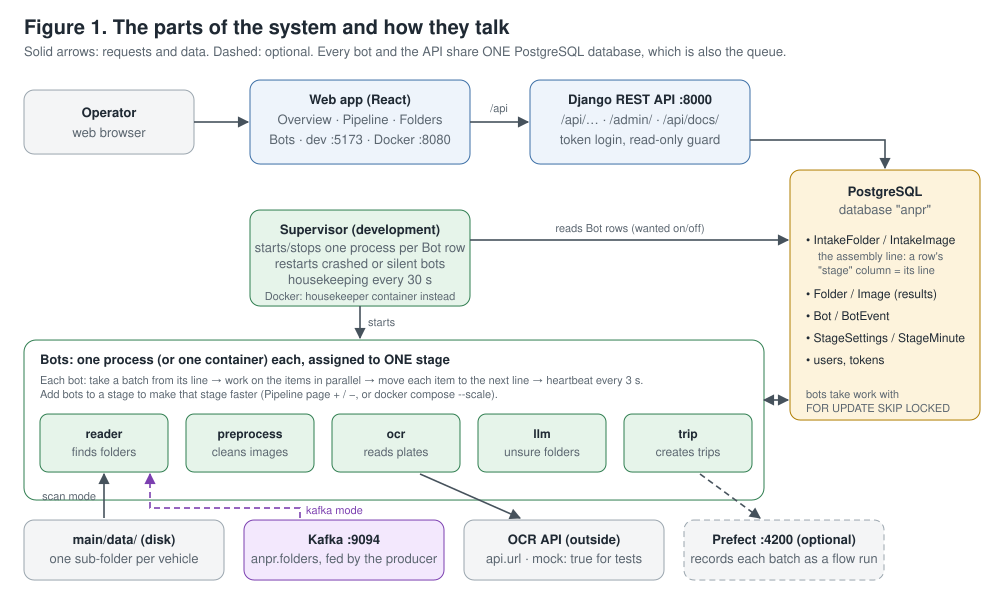
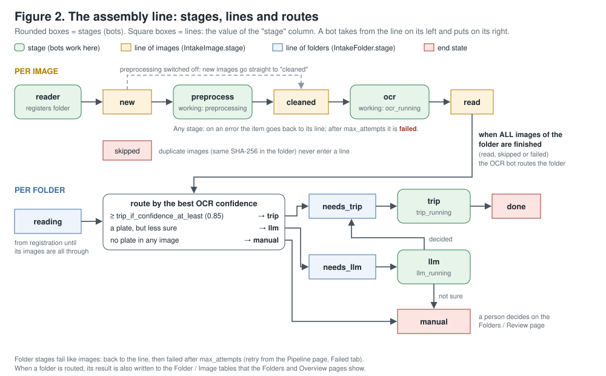

# ANPR

Reads number plates from vehicle-image folders on an **assembly line**:

reader → preprocess → OCR → LLM → trip

Each stage is worked by its own **bots**, and the whole line is run from a web app.

* **Full documentation:** [docs/GUIDE.md](docs/GUIDE.md), also as a PDF: [docs/ANPR-Guide.pdf](docs/ANPR-Guide.pdf). It covers:
  * the architecture and the flow;
  * every setup, the full configuration, scaling and tuning;
  * Kafka;
  * how to change the code, testing and troubleshooting.
* **Database:** [docs/DATABASE.md](docs/DATABASE.md) explains every table: what it stores, why it matters, how it grows.
* **API:**
  * Swagger at http://127.0.0.1:8000/api/docs/;
  * Postman collection in [docs/api/](docs/api/).





## How it works, in short

1. **A reader bot finds a new vehicle folder.**
   * In *scan* mode it scans `main/data/`.
   * In *Kafka* mode it receives one message per folder on topic `anpr.folders`, sent by the producer that watches `data/`.
   * It registers the folder, and the folder's images enter the first line.
2. **Preprocess bots clean the images.** This is a placeholder for now, and the stage can be switched off.
3. **OCR bots read the plates.** Each bot calls the OCR API with its own account and rate limit.
4. **The folder is routed by the best confidence once all its images are read:**
   * a sure plate goes to **trip**;
   * an unsure plate goes to the **LLM**;
   * no plate goes to a **person**, on the Review page.
5. **LLM and trip bots finish the job.** Both are placeholders for now.

**The lines are rows in PostgreSQL.** Any number of bots can take from the same line safely (`FOR UPDATE SKIP LOCKED`). To make a stage faster, add bots to it.

## Quick start: development

You need Python 3.12+, Node.js 20+, PostgreSQL and `make`.

```bash
cd ~/Anpr/main
make install                 # packages; creates main/.env from .env.example
```

Create the database once:

```bash
sudo -u postgres psql -c "CREATE USER anpr WITH PASSWORD 'choose-a-password' CREATEDB;"
sudo -u postgres psql -c "CREATE DATABASE anpr OWNER anpr;"
```

Put the same password in `main/.env`. Keep `ANPR_DB_ENGINE=postgres` and set `POSTGRES_PASSWORD`. Then:

```bash
make migrate && make superuser
make start                   # Prefect :4200 · API :8000 · supervisor + bots · web app :5173
```

Open http://127.0.0.1:5173 and log in. On the **Pipeline** page, press **+** on each stage. Vehicle folders go in `main/data/`.

OCR runs in mock mode by default (`api.mock: true` in `config/settings.yaml`), so the plates are fake.

## Quick start: Docker (one bot = one container)

```bash
cp envs/.env.docker.example envs/.env.docker   # set the password, DATABASE_URL, DJANGO_SECRET_KEY
touch envs/.env.ocr                              # optional OCR account for the OCR bots
make docker-up                                   # web app :8080 · API :8000 · Kafka UI :8081 (PREFECT=1 adds :4200)
make docker-superuser
make docker-scale STAGE=ocr N=3                  # more bots for one stage
```

The development API and the Docker API both use port 8000, so run only one setup at a time.

## Kafka mode

Set these in the env file:

```ini
ANPR_READER_MODE=kafka
KAFKA_BOOTSTRAP_SERVERS=localhost:9094    # inside Docker: kafka:9092
```

Then restart, and use:

```bash
make kafka-up                                # development: start Kafka only (Docker: part of docker-up)
make kafka-check                             # this machine can send and receive
make start                                   # in Kafka mode this also starts the PRODUCER:
                                             #   new folders in data/ -> anpr.folders -> reader bots
make logs-producer                           # what it sent (Docker: make docker-logs SERVICE=producer)
make kafka-publish                           # send ALL folders once more
make kafka-lag                               # partitions per reader, messages waiting
make kafka-failed                            # refused messages, with the reason
```

## Everyday commands

`make` alone lists them all.

| Development | Docker | What |
|---|---|---|
| `make start` / `stop` / `restart` | `make docker-up` / `docker-down` / `docker-restart` | start or stop everything |
| `make status` | `make docker-ps` | what runs |
| `make bots` | `make docker-bots` | every bot and every line |
| `make logs` / `logs-supervisor` | `make docker-logs SERVICE=bot-ocr` | logs |
| Pipeline page **+ / −** | `make docker-scale STAGE=ocr N=3` | bots per stage |
| `make report` | `make docker-report` | timing report |
| `make reprocess FOLDER="a b"` / `make reset` | `make docker-reprocess` / `docker-reset` | process again or start over |
| `make test` | | checks, unit tests, end-to-end test (never touches your data) |
| `make api-docs` / `make docs` | | rebuild the API docs, or this guide's PDF |

`make restart` (or `make docker-restart`) is needed after changing `config/settings.yaml`. Changes saved on the Pipeline page apply at once.

## Where things are

| Path | What |
|---|---|
| `config/settings.yaml` | every tunable value |
| `envs/` | per-environment settings and secrets (git-ignored) |
| `bots/` | the bot loop and what each stage does |
| `pipeline/` | stages, the OCR call, Kafka client |
| `services/reader/` | finding folders (scan) and Kafka messages |
| `web/` | Django: API, models, the queue, housekeeping, supervisor, tests |
| `~/Anpr/Frontend` | the React web app |
| `docs/` | the guide, its PDF, the figures, the API docs |
| `scripts/` | service runner, Docker scaling, e2e test, docs builders, Kafka tools |
| `unused/` | retired code, kept for reference only |
