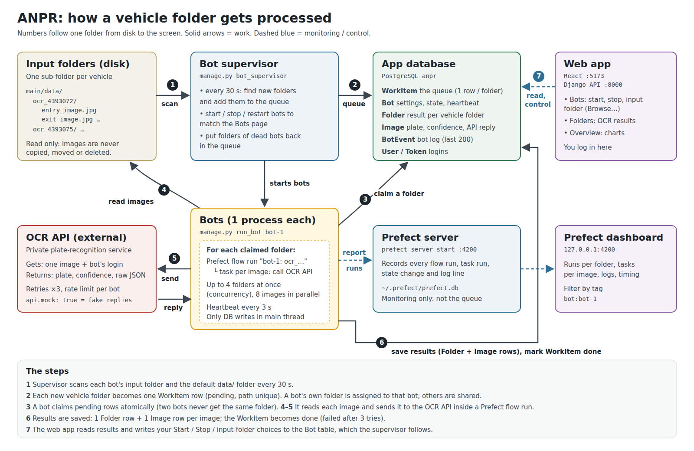
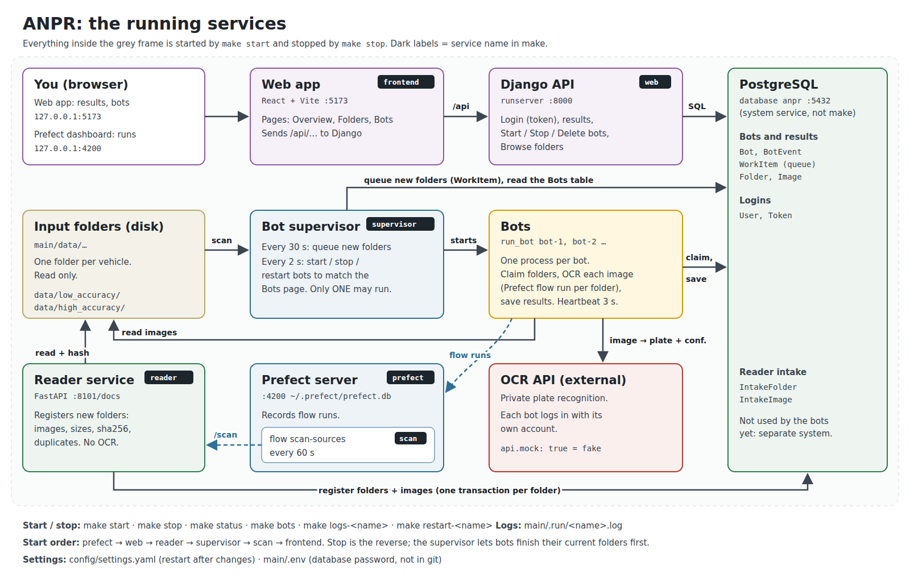
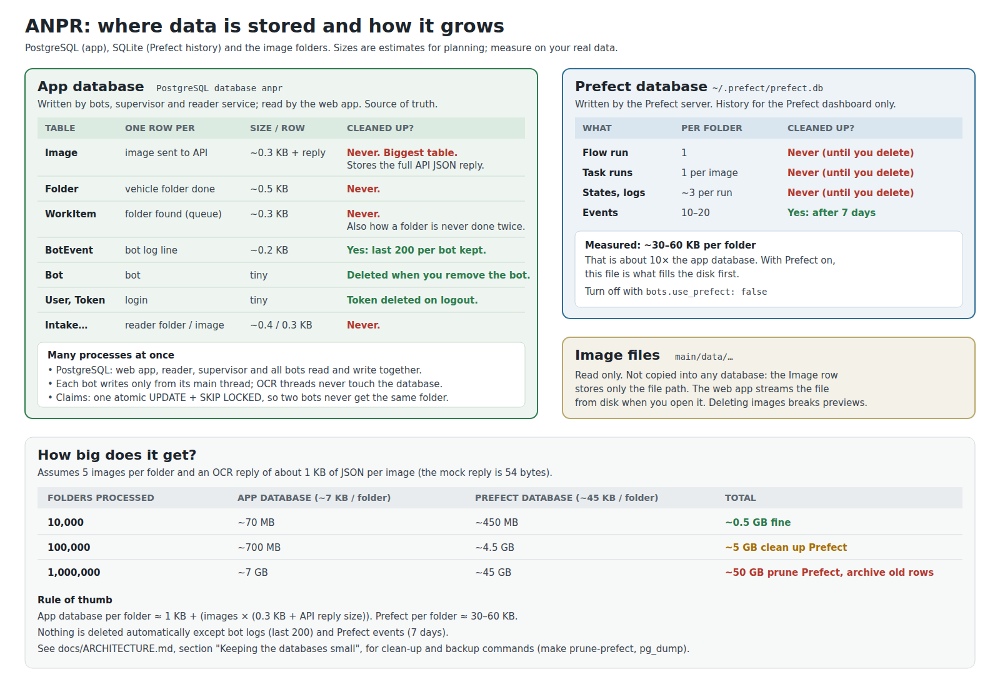

# ANPR: how the system works

This document explains what happens inside the system:
- how vehicle folders are found;
- how bots process them through Prefect and the OCR API;
- how results are stored;
- what the reader service does;
- how the databases grow.

For installing, running and using it, see the [README](../README.md).



---

## 1. What the system does

Cameras write one **folder per vehicle**, each containing a few images (`entry_image.jpg`, `exit_image.jpg`, `license_plate_crop.jpg`, …). The system:

1. finds new vehicle folders;
2. sends every image in a folder to a private **OCR API**, which returns the plate text and a confidence;
3. stores the results in **PostgreSQL**, so people can browse them in the **web app**.

Several **bots** do the work in parallel. Each bot has its own API account, speed limit and, optionally, its own input folder. Every folder a bot processes is recorded as a **Prefect flow run**, so it can be watched in the Prefect dashboard.

No decision rules are applied: the system saves what the OCR API returned. The highest-confidence plate is shown as the folder's plate, for display only. There are no local image checks either: no hashing, duplicate detection or quality scoring before sending.

Separately, a **reader service** registers new folders and their image fingerprints in intake tables. It is a newer, independent part that the bots don't use yet (section 6).

---

## 2. The parts



| Part | Started by `make start` as | Code | Job |
|---|---|---|---|
| **Input folders** | (disk) | `main/data/` | One sub-folder per vehicle. Read only: never moved, copied or deleted. |
| **Bot supervisor** | `supervisor` | `web/core/management/commands/bot_supervisor.py` | Every 30 s, finds new folders and queues them. Every 2 s, starts, stops and restarts bots to match the Bots page. Returns folders of dead bots to the queue. |
| **Bot** (one process per bot) | started by the supervisor (`manage.py run_bot <name>`) | `web/core/management/commands/run_bot.py` | Claims folders from the queue, processes them and saves the results. Sends a heartbeat every 3 s. |
| **Prefect flow** `anpr-bot-folder` | runs inside each bot | `pipeline/prefect_bot.py` | One flow run per folder, one task per image. Calls the OCR API. |
| **OCR API client** | – | `pipeline/api_client.py`, `pipeline/processor.py`, `pipeline/ratelimit.py` | Sends one image, retries up to 3 times, respects the bot's rate limit. |
| **Queue** | – | `web/core/queue.py` | Scan, add, claim, complete, fail and requeue folders. Stored in the `WorkItem` table. |
| **App database** | (system service) | PostgreSQL database `anpr` | Queue, bots, results, users, intake tables. |
| **Prefect server** | `prefect` | `~/.prefect/prefect.db` | Records flow and task runs for the dashboard at `http://127.0.0.1:4200`. |
| **Django API** | `web` | `web/core/api.py`, `bot_api.py` | REST API at `:8000/api/…` for the web app. Token login. |
| **Web app** | `frontend` | `Frontend/src/` | Pages: Overview, Folders, Bots. |
| **Reader service** | `reader` | `services/reader/` | FastAPI on `:8101`. Registers folders in `IntakeFolder` and `IntakeImage`. |
| **Scheduled scan** | `scan` | `pipeline/intake_flow.py` | Prefect flow `scan-sources`: calls `POST /scan` on each reader copy every 60 s. |
| **Settings** | – | `config/settings.yaml`, `main/.env` | All tunable values; database connection and password. |
| **Makefile** | – | `Makefile`, `scripts/services.sh` | Starts and stops all of the above; logs in `main/.run/`. |

---

## 3. The life of one folder

Follow `data/ocr_4393075/` from disk to screen. The numbers match the diagram at the top.

1. **Scan.** Every 30 s (`bots.scan_every_seconds`), the supervisor looks at each bot's input folder and at the default `data/` folder. It skips folders changed less than 30 s ago, because the camera may still be writing them (`processing.min_folder_age_seconds`).
2. **Queue.** Each new folder becomes one `WorkItem` row with status `pending`. If it is in a bot's own input folder, the row is **assigned** to that bot; otherwise it is **shared**.
3. **Claim.** A bot asks for up to `concurrency` folders (default 4). The claim is one atomic database update, so two bots can never get the same folder (section 5). The row becomes `in_progress`.
4. **Read images.** The bot lists the image files in the folder (`.jpg .jpeg .png .bmp`).
5. **OCR.** Each folder becomes a Prefect flow run called `bot-1: ocr_4393075`, and each image a task inside it, with up to 8 running in parallel. Each task:
   - sends the image to the OCR API with the bot's own login;
   - waits for the bot's rate limit;
   - retries up to 3 times on errors.
6. **Save.** The bot's main thread writes one `Folder` row, and one `Image` row per image with the plate, the confidence and the full API reply or error.
   - The folder is marked `processed`, or `failed` if every image got an API error.
   - Timing is recorded: per image `duration_ms` (rate-limit wait + read + OCR + retries) and `api_attempts`; per folder the `WorkItem` keeps `claimed_at` and `finished_at`. `make report` summarises them.
   - The `WorkItem` becomes `done`.
   - If the whole folder crashes (for example, it was deleted), the `WorkItem` goes back to `pending` and is retried. After 3 attempts it becomes `failed`; **Retry failed** on the Bots page queues it again.
7. **Show.** The web app reads `Folder` and `Image` through the API. Images are streamed from disk when you open them; they are never copied.

---

## 4. Bots: lifecycle and automation

The `Bot` table holds two kinds of columns. The web app writes **what you want**, and the bot and supervisor write **what is**:

| Written by the web app (what you want) | Written by bot / supervisor (what is) |
|---|---|
| `desired_running` (Start / Stop) | `state`: stopped, starting, running, stopping, crashed |
| `delete_requested` (Delete) | `pid`, `host`, `started_at` |
| `input_dir`, `concurrency`, `rate_limit`, API login | `last_heartbeat` (every 3 s), `current_task` |
| | `processed`, `failed`, `restarts`, `last_error` |

Every 2 seconds, the supervisor compares the two and fixes any difference. This is called *reconciliation*:

| Situation | Supervisor does |
|---|---|
| switched on, no process | starts `manage.py run_bot <name>` |
| switched off or delete requested, process alive | nothing; the bot sees it and exits after its current folders. Forced after `stop_grace_seconds` (60) |
| delete requested, process gone | deletes the `Bot` row (results stay) |
| process died with an error | marks it `crashed` and starts it again; switches it off after more than 5 crashes in 10 minutes |
| process alive but no heartbeat for 30 s | kills and restarts it |
| folder `in_progress` longer than `claim_timeout_seconds`, or its bot is dead | puts it back to `pending` |
| supervisor starts (`make start`) | marks every bot as stopped, then starts every bot that is switched on |
| supervisor receives Ctrl+C or SIGTERM (`make stop`) | stops all bots gracefully, then exits |

The bot itself:
- checks its row every heartbeat;
- stops claiming new folders when switched off;
- releases claimed folders it hasn't started;
- finishes those in progress, then exits.

**Run only one supervisor** per database. Two supervisors would each start a copy of every bot. `make start` refuses to start a second one.

### Which bot gets which folder

Each `WorkItem` row has an `assigned_bot`:

| `assigned_bot` | Who may take it |
|---|---|
| a bot | only that bot |
| empty ("shared") | any bot without its own input folder; **and** any bot with one, once its own folders are taken (`bots.help_shared_queue: true`, the default) |

How the input folder chosen on the Bots page (**Browse…**) is used:

| You choose… | What gets queued |
|---|---|
| a folder **with images directly inside** (`data/ocr_4393075`) | that one folder |
| a folder **of vehicle folders** (`data/gate1/`) | every sub-folder, now and when new ones appear |
| nothing (Clear) | the bot takes shared folders from the default `data/` |

Rules the supervisor applies on every scan:

- A folder is in the queue **only once** (unique path), so it is processed only once. Choosing a folder that is already `done` does nothing.
- A **waiting** folder you choose for a bot is moved to that bot, even if it was already queued as shared.
- When you change or clear a bot's folder, its old **waiting** folders go back to the shared pool.
- Folders `in_progress` or `done` are never moved.
- Two bots cannot watch the same folder.
- A bot claims its own folders first, then fills spare room with shared ones. It never takes another bot's folders. So every folder gets processed as long as one bot is switched on.
- With `bots.help_shared_queue: false`, bots only take their own folders, and shared folders wait for a bot without an input folder. `make bots` warns when none is switched on.

The Browse dialog only shows folders inside `paths.browse_roots` (default: `paths.input_dir`). Hidden folders are skipped, and anything outside is refused.

---

## 5. Why two bots never get the same folder

A bot claims folders like this ([web/core/queue.py](../web/core/queue.py), `claim`):

```sql
-- own folders first; then, with spare room, shared ones (same steps)
SELECT id FROM workitem WHERE status='pending' AND assigned_bot=<me>
ORDER BY id LIMIT <concurrency> FOR UPDATE SKIP LOCKED;

-- then, for each id:
UPDATE workitem SET status='in_progress', bot=<me>, attempts=attempts+1
WHERE id=<id> AND status='pending';
```

- PostgreSQL runs each `UPDATE` as one indivisible step. If another bot took the row a moment earlier, the `WHERE status='pending'` no longer matches: 0 rows change, and this bot skips it.
- `SKIP LOCKED` makes bots skip rows another bot is looking at right now, so they pick different rows instead of waiting for each other.
- A folder can enter the queue only once, because `WorkItem.path` is unique.

The end-to-end test (`make test-e2e`) checks that no folder is ever processed twice.

---

## 6. The reader service

`services/reader/` is a small FastAPI service that **registers** new vehicle folders. It doesn't call the OCR API. **The bots don't read its tables yet**: the bot queue (`WorkItem`) and the intake tables are two separate systems.

What one scan (`POST /scan`) does for each source in `reader.sources` (`scanner.py`):

1. Lists the sub-folders with `os.scandir`, which stays fast even with millions of entries.
2. Keeps only the folders that belong to this copy's **shard** (below).
3. Skips folders already registered (one query per 1,000 paths) and folders changed in the last `min_folder_age_seconds`.
4. Reads the rest in `read_workers` threads. For each image it records the name, size, modified time and **sha256** of the whole file, and marks it as a **duplicate** if an earlier image in the same folder has the same sha256.
5. Saves each folder and its images in **one transaction**, so there is never a folder without its images. Database writes happen only in the main thread.

What it stores:

| Table | One row per | Columns |
|---|---|---|
| `IntakeFolder` | vehicle folder | `path` (unique), `name`, `source`, `accuracy` (low/high), `priority`, `status` (`new`, processing, done, failed), `image_count`, `duplicate_count`, `total_bytes`, `folder_modified_at`, `discovered_at`, `discovered_by` |
| `IntakeImage` | image | `folder`, `file_name`, `path`, `size_bytes`, `sha256`, `is_duplicate`, `modified_at` |

`status` is set to `new` and nothing changes it yet. The index `(status, priority, discovered_at)` is the order a future consumer should take folders in: lowest priority number first, then oldest.

**What it reads:**
- `/folders`, `/folders/{id}` and `/stats` read only these two tables.
- `/images/{id}/file` reads the stored path and sends the file, but only if it lies inside a configured source.
- `/health` only checks the database connection and whether the source folders exist.

**Several copies (sharding).** Start each copy with `--shard N/M`. A folder's name is turned into a number (an md5 hash), and the folder belongs to copy `(number % M) + 1`. Every copy works out the same answer without talking to the others. If two copies ever registered the same folder, the unique `path` would let only the first one succeed.

**Scheduled scans.** `pipeline/intake_flow.py` is a Prefect flow, `scan-sources`. It calls `POST /scan` on every URL in `reader.instances` at the same time and logs each copy's result. `make start` serves it every `reader.scan_every_seconds` (60). Run it once with `python -m pipeline.intake_flow`.

**Settings:** `--env NAME` sets `ANPR_ENV`, which `/health` shows. `ANPR_READ_ONLY=1` makes `/scan` return 403.

---

## 7. Bots and Prefect

- The **bot** owns the work: queue, Start/Stop, input folder, saving results, counting done and failed.
- **Prefect** runs and records the OCR part. In the dashboard:
  - flow `anpr-bot-folder` has one run per folder, named `bot-name: folder-name` and tagged `bot:<name>`;
  - each task run is named `ocr <image file>`.
- API passwords are never flow parameters, so they never appear in Prefect.
- The Prefect server must be running while bots run with `bots.use_prefect: true`.
- `bots.use_prefect: false` turns Prefect off; bots then call the same code directly.
- `pipeline/flows.py` is the older, separate Prefect pipeline. It is kept but **not used**. Do not run it on the same folders.

---

## 8. How data is stored



### App database: PostgreSQL `anpr`

The source of truth. Connection settings are in `main/.env` (`ANPR_DB_ENGINE=postgres`, `POSTGRES_*`). Without them, Django falls back to a SQLite file, `web/db.sqlite3`, which the tests use.

| Table (`core_…`) | One row per | What's in it | Cleaned up? |
|---|---|---|---|
| `workitem` | folder found by the supervisor | path (unique), status, assigned bot, claiming bot, attempts, last error | **Never.** Also what stops a folder being processed twice. |
| `folder` | folder processed | name, path, status, best plate and confidence, which bot | **Never.** |
| `image` | image sent to the API | file path, plate, confidence, **full API JSON reply**, API error, `duration_ms` and `api_attempts` (timing, see README: Timing report) | **Never.** Largest table. |
| `bot` | bot | settings, encrypted API password, wanted and real state, heartbeat, counters | When you delete the bot |
| `botevent` | bot log line | time, level, message | Last 200 per bot are kept |
| `intakefolder` | folder registered by the reader | see section 6 | **Never.** |
| `intakeimage` | image registered by the reader | path, size, sha256, duplicate flag | **Never.** |
| `auth_user`, `authtoken_token` | login | Django users, API tokens | Token deleted on logout |
| `job` | old `flows.py` run | – | Not used |

How many processes share the database safely:

- PostgreSQL handles many readers and writers at once: the web app, the reader service, the supervisor and every bot.
- Each bot writes only from its main thread. OCR calls happen in worker threads that don't touch the database.
- Django keeps connections open for 60 s (`CONN_MAX_AGE`) and checks them before use.
- **Images are not stored**, only their paths. Deleting or moving image files breaks the previews in the web app, but not the stored results.

### Prefect database: `~/.prefect/prefect.db`

History for the Prefect dashboard only; the app never reads it.
- **Per folder:** 1 flow run, 1 task run per image, their state changes, log lines and events.
- **Size:** measured at about **30–60 KB per folder**, roughly 6–10× the app database.
- **Clean-up:** events are deleted automatically after 7 days. Runs, states and logs are kept until you delete them (section 9).

### Growth

Assuming 5 images per folder and about 1 KB of JSON per OCR reply:

| Folders | App database | Prefect database | Reader intake tables |
|---|---|---|---|
| 10,000 | ~70 MB | ~450 MB | ~20 MB |
| 100,000 | ~700 MB | ~4.5 GB | ~200 MB |
| 1,000,000 | ~7 GB | ~45 GB | ~2 GB |

- App database per folder ≈ 1 KB + images × (0.3 KB + API reply size).
- Intake per folder ≈ 0.4 KB + images × 0.3 KB, mostly the paths and the 64-character hashes.

These are planning estimates. Check the real sizes after the first few thousand folders:

```bash
psql -h localhost -U anpr anpr -c "SELECT relname, pg_size_pretty(pg_total_relation_size(relid)) FROM pg_catalog.pg_statio_user_tables ORDER BY pg_total_relation_size(relid) DESC;"
ls -lh ~/.prefect/prefect.db
```

### Memory (RAM) of the running processes

- **Supervisor:** small and constant. It reads folder names with `os.scandir` and inserts them in batches of 5,000, so even millions of folders don't load into memory at once.
- **Each bot:** works on at most `concurrency` folders (default 4), with up to 8 images per folder in flight. Each image is read from disk while it is sent.
  - Worst case ≈ concurrency × 8 × largest image (4 × 8 × 3 MB ≈ 100 MB), usually much less.
  - Results are held only until saved. Prefect results are not persisted (`persist_result=False`).
- **Reader service:** reads each file in 1 MB chunks to hash it, with `read_workers` (8) folders at a time and 1,000 paths per batch.
- **Web app lists** are paged (50 rows per page).

---

## 9. Keeping the databases small

**Prefect history** is the biggest. Delete old runs whenever you like; results in the app are not affected:

```bash
make prune-prefect DAYS=30
```

Run it weekly (later: cron or a systemd timer). If you don't need the Prefect dashboard, `bots.use_prefect: false` stops this growth completely.

**App database.** Do **not** delete `WorkItem` rows: their folders would be processed again on the next scan. Options, from least to most effort:

1. Keep everything. PostgreSQL handles millions of rows easily.
2. Clear the stored API replies of old images. This keeps the plate and confidence:
   ```bash
   cd ~/Anpr/main/web
   python manage.py shell -c "from core.models import Image; from django.utils import timezone; from datetime import timedelta; print(Image.objects.filter(processed_at__lt=timezone.now()-timedelta(days=90)).update(api_response={}))"
   ```
3. Archive old `Folder` and `Image` rows to another database, or partition the tables by month, once they reach tens of millions of rows.

PostgreSQL reuses space freed by deletes automatically (autovacuum). It gives space back to the disk only after `VACUUM FULL`, which locks the table: run it with the bots stopped.

**Backups:**
```bash
pg_dump -h localhost -U anpr -Fc anpr > anpr_$(date +%F).dump        # backup (bots can keep running)
pg_restore -h localhost -U anpr -d anpr --clean anpr_2026-11-11.dump  # restore
```

---

## 10. Known limits

- **Mock mode is on** (`api.mock: true`): plates are fake until the real API URL is set.
- Each folder is processed **once**. Images added to a folder after it was processed are ignored, and there is no "Reprocess" button yet.
- The reader service and the bots are **not connected**. Intake folders stay `new`, and the bots use their own scan and queue. Connecting them needs an atomic claim on `IntakeFolder` like the one in section 5.
- The reader hashes images and marks duplicates; the bots deliberately don't.
- `make start` runs everything in the background of your user session. To start at boot, the services should become systemd units.
- The Overview page still has charts from the old decision rules (accepted / review / no plate).

---

## 11. File map

```
Anpr/
├── .venv/                              Python environment
├── Frontend/                           web app (React + Vite)
│   ├── src/pages/Bots.jsx              bots, queue, input folder
│   ├── src/pages/Folders.jsx           results list
│   └── src/components/FolderPicker.jsx Browse… dialog
└── main/
    ├── Makefile                        install / start / stop / status / bots / test
    ├── .env, .env.example              database connection (+ password, not in git)
    ├── config/settings.yaml            all other settings
    ├── data/                           input vehicle folders (not in git)
    ├── docs/                           this document + diagrams (svg sources, png renders)
    ├── scripts/
    │   ├── services.sh                 start/stop/status of services (used by make)
    │   ├── e2e_test.sh                 end-to-end test (make test-e2e)
    │   └── prune_prefect_runs.py       delete old Prefect history
    ├── pipeline/
    │   ├── prefect_bot.py              Prefect flow used by bots
    │   ├── processor.py                list images, call API with retries
    │   ├── api_client.py               OCR API request / reply parsing (and mock)
    │   ├── ratelimit.py                calls-per-second limit
    │   ├── intake_flow.py              Prefect flow scan-sources (calls the reader)
    │   ├── config.py                   loads settings.yaml (ANPR_CONFIG overrides the path)
    │   └── flows.py, decision.py, quality.py   old standalone pipeline (unused)
    ├── services/
    │   ├── common/django_setup.py      lets a service use the Django models
    │   └── reader/                     reader service: __main__.py (options), app.py (endpoints), scanner.py
    ├── tests/                          pytest: reader, rate limiter, old decision rules
    └── web/
        ├── anpr_web/settings.py        Django settings (database from .env)
        └── core/
            ├── models.py               tables
            ├── migrations/             table changes, applied with make migrate
            ├── queue.py                queue, folder scanning, atomic claim
            ├── ingest.py               save results
            ├── api.py, bot_api.py      REST API
            ├── tests.py                Django tests
            └── management/commands/
                ├── bot_supervisor.py   the supervisor
                ├── run_bot.py          one bot
                ├── bots.py             make bots
                ├── reset_results.py    make reset / make reprocess
                └── report.py           make report (timing)
```
