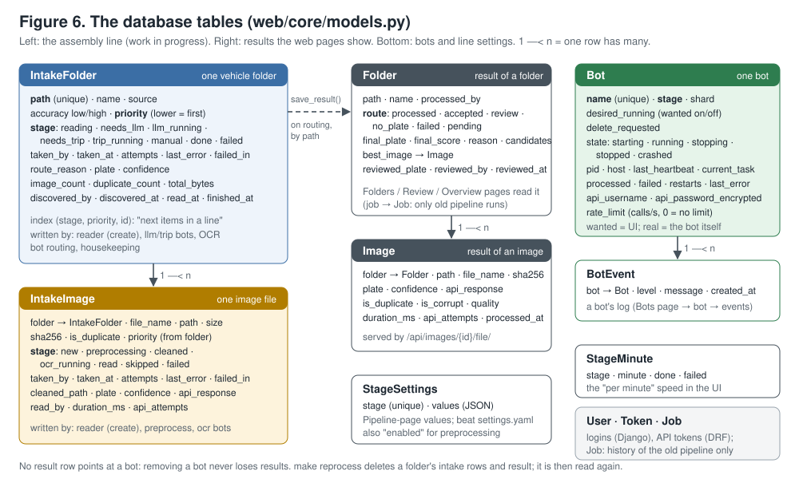

# Database reference: every table, what it stores, and why it matters

The whole system keeps its state in **one PostgreSQL database** (`anpr`; in Docker the `postgres` container, volume `pgdata`). Bots, the supervisor, the housekeeper and the web API all read and write the same tables. Because there are no hidden files or in-memory queues, this database **is** the system's memory: back it up and you can rebuild everything else.

The tables are defined in `web/core/models.py` (our tables, named `core_<model>`) plus the standard tables of Django and Django REST Framework.

## Overview

| Table (PostgreSQL name) | Group | One row per | Written by | Read by | Size today* |
|---|---|---|---|---|---|
| **IntakeFolder** (`core_intakefolder`) | assembly line | vehicle folder found | reader bots, OCR/LLM/trip bots, housekeeping | bots, Pipeline page, report | 86 |
| **IntakeImage** (`core_intakeimage`) | assembly line | image file in a folder | reader, preprocess and OCR bots | bots, Pipeline page, report | 502 |
| **Folder** (`core_folder`) | results | folder that has been routed | OCR bot (`save_result`), Review page | Folders, Review, Overview pages | 86 |
| **Image** (`core_image`) | results | image of a routed folder | OCR bot (`save_result`) | Folders page, image files | 502 |
| **Bot** (`core_bot`) | bots | bot (worker) | web app (wanted state), the bot itself (real state) | supervisor, housekeeper, Bots / Pipeline pages | 6 |
| **BotEvent** (`core_botevent`) | bots | log line of a bot | bots, supervisor, housekeeper, API | Bots page (events) | 7 |
| **StageSettings** (`core_stagesettings`) | line settings | stage with changed settings | Pipeline page | every bot, before every batch | 1 |
| **StageMinute** (`core_stageminute`) | line monitoring | stage per minute | every bot after a batch | Pipeline page (speed), report | 3 |
| **Job** (`core_job`) | legacy | run of the old pipeline | nothing any more | Folders page (old rows only) | 0 |
| `auth_user`, `authtoken_token` | logins | person / login token | `make superuser`, admin, login | the API (who is calling) | 3 / 2 |
| `django_*`, other `auth_*` | framework | – | Django | Django | – |

\* Counts from the development database on 16 Nov 2026, for scale only.

**Two halves.**

* The **assembly line** tables (`IntakeFolder`, `IntakeImage`) hold *work in progress*: where every folder and image is right now.
* The **result** tables (`Folder`, `Image`) hold *finished answers* that people look at and review.

They are kept apart on purpose:

* The line can be reset, retried or moved to Kafka without touching what people reviewed.
* The pages never have to understand queue bookkeeping.

---

## 1. Assembly line tables

### IntakeFolder: one vehicle folder on the assembly line

**What it is for.** Created the moment a reader bot finds a vehicle folder (scan mode) or receives its Kafka message. From then on it says where the folder is on the line. Its `stage` column **is** the folder-level queue (see the guide, section 3).

**Why it is important.**

* **It is the "already seen" memory.** The unique `path` guarantees a folder is registered and processed once, even with many reader bots or a Kafka message delivered twice. Delete a row and that folder is processed again (this is exactly what `make reprocess` does).
* **It is the queue of the LLM and trip stages.** Bots take rows with `SELECT … FOR UPDATE SKIP LOCKED` on the index `(stage, priority, id)`.
* **It records why** each folder went to trip, the LLM or a person (`route_reason`).

| Column | Type | Meaning |
|---|---|---|
| `id` | integer | row id |
| `path` | text, **unique** | full path of the folder on disk; the identity of a folder |
| `name` | text, indexed | the folder's name (the vehicle id, e.g. `ocr_4393072`) |
| `source` | text, indexed | which `reader.sources` entry it came from; `kafka` when it came from a message |
| `accuracy` | `low` / `high` | the camera's accuracy class |
| `priority` | small int, indexed | lower = processed first (low accuracy before high) |
| `stage` | text, indexed | where it is: `reading` (images still in progress), `needs_llm`, `llm_running`, `needs_trip`, `trip_running`, `manual`, `done`, `failed` |
| `taken_by` | text | name of the bot holding it right now (LLM / trip stages), else empty |
| `taken_at` | time | when that bot took it; housekeeping uses it to find stuck items |
| `attempts` | small int | tries in the current stage; at `max_attempts` it becomes `failed` |
| `last_error` | text | the last error message |
| `failed_in` | text | the stage it failed in; **Retry** sends it back there |
| `route_reason` | text | why it went where it went, e.g. `MH12AB1234 read with confidence 0.93 (3 image(s) agree)` |
| `plate` | text | best plate the OCR read across its images |
| `confidence` | float | that plate's confidence (0–1) |
| `read_at` | time | when its last image finished OCR (end of the "folder time" in the report) |
| `image_count` | int | images in the folder |
| `duplicate_count` | int | images that are exact copies of another image in the folder |
| `total_bytes` | bigint | size of all its images |
| `folder_modified_at` | time | the folder's modification time on disk |
| `discovered_at` | time, indexed | when it was registered (start of the "folder time") |
| `discovered_by` | text | the reader bot that registered it |
| `finished_at` | time | when it reached `done`, `manual` or `failed` |

**Lifecycle.** Created by a reader → `reading` → routed by the OCR bot that finishes its last image → `needs_trip` / `needs_llm` / `manual` → … → `done`. Never deleted automatically; `make reprocess` / `make reset` delete rows (with their images and results) so folders are processed again.

**Growth.** One row per vehicle, forever (about 1 KB per row).

### IntakeImage: one image on the assembly line

**What it is for.** One row per image file of a registered folder. Its `stage` column is the **image-level queue** for preprocessing and OCR, and it stores the OCR's raw answer for that image.

**Why it is important.**

* **It is where the actual work is tracked.** Each image goes through preprocessing and OCR on its own, so the image stages can scale independently of the folders.
* **It decides the folder's route.** The OCR answers stored here (`plate`, `confidence`) are what `decide()` routes the folder by.
* **It feeds the timing report.** `read_by`, `duration_ms` and `api_attempts` show each OCR bot's speed and how many retries the API needed.

| Column | Type | Meaning |
|---|---|---|
| `id` | integer | row id |
| `folder_id` | → IntakeFolder | the folder it belongs to (deleting the folder deletes its images) |
| `file_name`, `path` | text | the file's name and full path |
| `size_bytes` | bigint | file size |
| `sha256` | text, indexed | fingerprint of the content: equal hash = identical image |
| `is_duplicate` | bool | same content as another image of the same folder: it is not processed |
| `modified_at` | time | the file's modification time |
| `stage` | text, indexed | `new` (waiting for preprocessing), `preprocessing`, `cleaned` (waiting for OCR), `ocr_running`, `read`, `skipped` (duplicate), `failed` |
| `priority` | small int | copied from the folder, so low-accuracy images are taken first |
| `taken_by`, `taken_at`, `attempts`, `last_error`, `failed_in` | | queue bookkeeping, as in IntakeFolder |
| `cleaned_path` | text | where preprocessing put the cleaned copy (today: the original path) |
| `plate`, `confidence` | text, float | what the OCR read |
| `api_response` | JSON | the OCR API's full answer, kept for checking and debugging |
| `read_by` | text | the OCR bot that read it |
| `duration_ms` | int | rate-limit wait + reading the file + OCR call + retries |
| `api_attempts` | small int | OCR calls made (1 = it worked the first time) |

**Lifecycle.** Created with its folder (`new`, or `cleaned` when preprocessing is switched off; duplicates `skipped`) → `preprocessing` → `cleaned` → `ocr_running` → `read` or `failed`. When the last image of a folder is finished, the folder is routed.

**Growth.** One row per image, forever; the largest table. Mostly because of `api_response`: count roughly 1–3 KB per row, depending on the size of the API's answers.

---

## 2. Result tables (what the web pages show)

### Folder: the result of one folder

**What it is for.** Written once a folder is routed (`ocr_results.save_result`) and then changed by people on the Review page. The **Folders**, **Review** and **Overview** pages read only this table and Image.

**Why it is important.**

* **It is the business answer:** which plate this vehicle has, how sure the system is, and whether a person approved, corrected or rejected it.
* **It is the audit trail for people:** reviewers' decisions are stored here (`reviewed_*`), never in the line tables.

| Column | Type | Meaning |
|---|---|---|
| `id` | integer | row id (the `{id}` in `/api/folders/{id}/`) |
| `path`, `name` | text | same as the IntakeFolder (matched by `path`) |
| `processed_by` | text | the OCR bot(s) that read its images, most images first |
| `route` | text, indexed | `processed` (OCR answered), `failed` (no image could be read), `accepted` (a person approved/corrected), `no_plate` (a person rejected), `review`, `pending` (older pipeline values) |
| `scenario` | text | older pipeline only |
| `reason` | text | the routing reason (same as `IntakeFolder.route_reason`) |
| `final_plate`, `final_score` | text, float | best plate and its confidence |
| `best_image_id` | → Image | the image that gave the best plate (shown first) |
| `candidates` | JSON | older pipeline only: plates and their scores |
| `reviewed_plate`, `reviewed_by`, `reviewed_at` | | what a person decided on the Review page, who, and when |
| `job_id` | → Job | older pipeline only; empty for everything the bots process |
| `created_at` | time | when the result was written |

**Lifecycle.** Created when the folder is routed. If the folder is processed again (`make reprocess`), its old row is replaced. A review updates it and copies approved folders to `paths.output_dir`.

**Growth.** One row per routed folder, forever.

### Image: the result of one image

**What it is for.** A copy of each image's OCR result at the moment its folder was routed, for the folder detail page and `/api/images/{id}/file/` (which serves the picture).

**Why it is important.**

* **It lets a reviewer see the evidence:** each picture, what the OCR read in it, and how sure it was.
* **It stays stable** even if the line tables are later cleared or moved elsewhere.

| Column | Type | Meaning |
|---|---|---|
| `id` | integer | row id (the `{id}` in `/api/images/{id}/file/`) |
| `folder_id` | → Folder | its folder result (deleted with it) |
| `path`, `file_name`, `sha256`, `is_duplicate` | | as in IntakeImage |
| `plate`, `confidence`, `final_score` | | what the OCR read (final_score = confidence today) |
| `api_response` | JSON | the OCR API's full answer |
| `api_error` | text | the error, if this image failed |
| `duration_ms`, `api_attempts` | | timing, as in IntakeImage |
| `is_corrupt`, `quality`, `quality_details` | | older pipeline only (image quality scoring) |
| `processed_at` | time | when the result row was written |

**Growth.** One row per image, forever; about as large as IntakeImage.

---

## 3. Bot tables

### Bot: one worker

**What it is for.** The control panel of every bot. It holds two kinds of columns:

* **Wanted state:** `desired_running`, `delete_requested`, set by the web app or the API.
* **Real state:** `state`, `pid`, `last_heartbeat` and the counters, written by the bot itself and the supervisor.

The supervisor (development) and the housekeeper (Docker) compare the two and act.

**Why it is important.**

* **It is how you control the line without touching servers.** Start, stop, add and remove are just changes to this table; the supervisor makes reality match.
* **It is how dead bots are noticed.** No heartbeat for `stale_after_seconds` means dead: the supervisor restarts it, and its held items are given back.
* **It holds each OCR bot's own API account and rate limit.** The password is stored encrypted.

| Column | Type | Meaning |
|---|---|---|
| `id` | integer | row id |
| `name` | slug, **unique** | the bot's name (`ocr-1`, or `ocr-<container id>` in Docker); `taken_by` in the line tables holds this name |
| `stage` | text, indexed | `reader`, `preprocess`, `ocr`, `llm` or `trip`: the only line it takes from |
| `shard` | text | reader bots: `2/3` in scan mode, `kafka` in Kafka mode |
| `api_username` | text | its account at the outside service (the OCR API) |
| `api_password_encrypted` | text | the password, Fernet-encrypted with a key derived from `DJANGO_SECRET_KEY`; never returned by the API |
| `rate_limit` | float | the most API calls per second this bot makes (0 = no limit) |
| `desired_running` | bool | **wanted**: on (Start) or off (Stop; Pause in Docker) |
| `delete_requested` | bool | **wanted**: remove it after its current batch |
| `state` | text | **real**: `starting`, `running`, `stopping`, `stopped`, `crashed` |
| `pid`, `host` | | the process id and machine (container id in Docker) |
| `started_at` | time | when the current run started |
| `last_heartbeat` | time | written every 3 s by the bot; the "alive" signal |
| `current_task` | text | what it is doing now (`Batch 12: 20 items`, `Waiting for messages`) |
| `processed`, `failed` | int | items it finished / that failed, since it was created (or the last reset) |
| `last_error` | text | its last error |
| `restarts` | int | how often the supervisor had to restart it |
| `created_at` | time | when the bot was added |

**Growth.** One row per bot. In Docker the housekeeper removes the rows of containers that are gone.

### BotEvent: a bot's log

**What it is for.** Short log lines, shown on the Bots and Pipeline pages when you open a bot. They are written by:

* the bot: started, paused, rate limit changed, batch failures, Prefect not reachable;
* the supervisor: started, crashed, restarted;
* the housekeeper: new reader shard.

**Why it is important.** It answers "what happened to this bot?" from the browser, without server logs. Most problems (no API account, OCR errors, Kafka problems) show up here first.

| Column | Type | Meaning |
|---|---|---|
| `id` | integer | row id |
| `bot_id` | → Bot | whose event (deleted with the bot) |
| `created_at` | time, indexed | when |
| `level` | text | `info`, `warning` or `error` |
| `message` | text | the event |

**Growth.** A few rows per bot start and stop, plus one per failed batch. **Nothing deletes old events yet**, so the table grows slowly forever. They disappear with their bot, or with `make reset`.

---

## 4. Line settings and monitoring

### StageSettings: settings changed on the Pipeline page

**What it is for.** One row per stage whose settings were changed on the Pipeline page. `values` holds only the changed keys, e.g. `{"batch_size": 50, "enabled": false}`. A stage's effective settings = `config/settings.yaml` → `stages.<stage>`, overridden by these values.

**Why it is important.**

* **It is how the line is tuned live:** bots re-read it before every batch, so a change applies within seconds without a restart.
* **It holds the preprocessing on/off switch** (`"enabled"`), and therefore decides which line new images enter.

| Column | Type | Meaning |
|---|---|---|
| `stage` | text, **unique** | the stage |
| `values` | JSON | the changed settings (removing a key = back to the file's value) |
| `updated_at`, `updated_by` | | when and by whom (the logged-in user) |

**Growth.** At most one row per stage. `make reset` keeps it.

### StageMinute: speed per stage

**What it is for.** For each stage and each minute: how many items were finished and how many failed. Bots add their counts after every batch.

**Why it is important.**

* **It is the "done / min" speed on the Pipeline page** and the trend that tells you which stage is the bottleneck.
* **It is cheap to read**, so the page never has to count the big tables.

| Column | Type | Meaning |
|---|---|---|
| `stage` | text | the stage (`reader` counts registered folders) |
| `minute` | time | the minute (seconds set to 0) |
| `done`, `failed` | int | items finished / failed in that minute |

`(stage, minute)` is unique, so concurrent bots add to the same row.

**Growth.** At most 5 rows per minute while the line runs (about 7 200 per day at full use; tiny rows). **Nothing deletes old rows yet.** Only the last few minutes are used, so old rows can be deleted at any time.

### Job: legacy

Runs of the first pipeline version (one Prefect flow processing a whole input folder). Nothing writes it any more. It exists only because old `Folder` rows may point at a job. It is safe to ignore; `make reset` empties it.

---

## 5. Framework tables

| Table | What it holds | Why it matters |
|---|---|---|
| `auth_user` | web app logins (username, **hashed** password, staff/superuser flags) | who may use the app; reviewers' names come from here |
| `authtoken_token` | one API token per logged-in user | the web app sends it with every request (`Authorization: Token …`); logging out deletes it |
| `auth_group`, `auth_permission`, `auth_*_permissions` | Django's groups and permissions | used by the admin; the app itself only checks "logged in" |
| `django_session` | admin login sessions | `/admin/` |
| `django_admin_log` | changes made in `/admin/` | who changed what in the admin |
| `django_content_type` | Django's list of models | internal |
| `django_migrations` | which migrations ran | `make migrate` uses it to know what's missing; never edit by hand |

---

## 6. How the tables work together (one folder's journey)

1. **Registration.** A reader registers the folder and its images in **one transaction**: an `IntakeFolder` (`reading`) plus its `IntakeImage` rows (`new`, or `cleaned` when preprocessing is off). A `StageMinute` count is added for `reader`.
2. **Preprocessing and OCR.** Preprocess and OCR bots move the images through their stages. Each holds its images via `taken_by`/`taken_at` and fills `cleaned_path`, then `plate`, `confidence`, `api_response` and timing. The bots' `Bot` counters and `StageMinute` rows go up.
3. **Routing.** The OCR bot finishing the last image routes the `IntakeFolder` (`needs_trip` / `needs_llm` / `manual`, with `route_reason`). In the **same transaction** it writes the `Folder` + `Image` result rows.
4. **LLM and trip.** LLM and trip bots move the `IntakeFolder` on to `done` (or `manual`).
5. **Review.** A person reviews the `Folder` on the Review page: `reviewed_*`, and `route` becomes `accepted` or `no_plate`.

Throughout, the bots write `last_heartbeat` to `Bot` and log to `BotEvent`, and read `StageSettings` before every batch.

## 7. Deleting data safely

| You want to | Do | Never |
|---|---|---|
| process some folders again | `make reprocess FOLDER="…"` (deletes their IntakeFolder + IntakeImage + Folder + Image together; Kafka mode: the producer resends them) | delete only `Folder` rows: the line still thinks they're done |
| start over | `make reset` / `make docker-reset` (empties line, results, BotEvent, StageMinute, Job; keeps Bot, StageSettings, logins) | `TRUNCATE` by hand: easy to leave half a folder behind |
| remove a bot | Bots page → Remove (it finishes its batch first) | delete a `Bot` row while it runs: its process keeps going without a row |
| trim the logs | `DELETE FROM core_stageminute WHERE minute < now() - interval '7 days';` and the same for `core_botevent.created_at`: both are safe | – |
| back up | `pg_dump -Fc anpr > backups/anpr_$(date +%Y%m%d_%H%M).dump` (Docker: `docker compose exec postgres pg_dump -U anpr -Fc anpr > …`) | – |

**What is irreplaceable:**

* the **review decisions** (`Folder.reviewed_*`);
* the **bot accounts** (`Bot.api_*`);
* the **logins** (`auth_user`).

Everything else can be rebuilt by processing the image folders again. Back up the database before migrations and before `make reset`.
